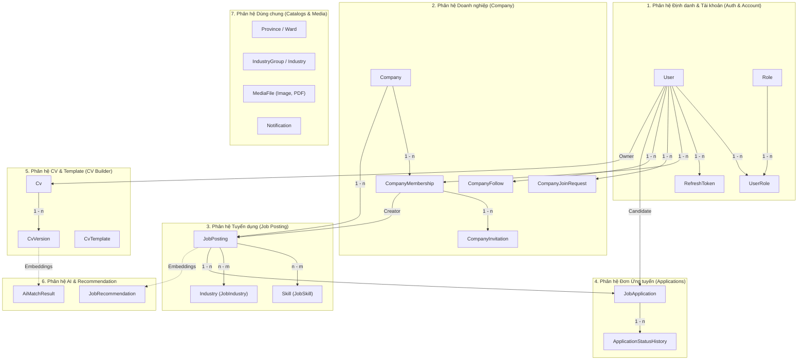

# Bối cảnh Toàn bộ Dự án SmartHire & Trạng thái Hệ thống (Comprehensive System Context)

Tài liệu này tổng hợp **toàn bộ kiến trúc, các phân hệ, schema dữ liệu, các quyết định thiết kế đã thống nhất, trạng thái công việc và các lưu ý quan trọng** của toàn bộ dự án SmartHire, phục vụ cho bất kỳ AI agent nào tiếp nối công việc ở conversation mới.

---

## 1. Tổng quan Dự án

- **Tên dự án:** **SmartHire** — Nền tảng tuyển dụng thông minh.
  - Hỗ trợ kết nối nhà tuyển dụng (Recruiter) và ứng viên (Candidate).
  - So khớp tự động giữa CV và Tin tuyển dụng (JD) bằng AI.
  - Hỗ trợ ứng viên tạo và chỉnh sửa CV trực tuyến dạng WYSIWYG, AI gợi ý câu từ/ngữ pháp (chỉ gợi ý, không tự ý sửa).
- **Git Repo:** `smart-recruitment-app`
- **Nhánh đang làm việc:** `fix/105-improve-apis-responses` (tách từ `develop`, PR vào `develop`).
- **Tech Stack:**
  - **Backend:** .NET 10 Web API, C# 13, Clean Architecture, MediatR (CQRS), Entity Framework Core (PostgreSQL), Hangfire (Background jobs), JWT Auth (Silent Refresh qua HttpOnly Cookie).
  - **Frontend:** React 19, Vite 8, TypeScript, Tailwind CSS v4, Zustand, TanStack Query, React Hook Form + Zod, TipTap Editor, Framer Motion, Lucide Icons.

---

## 2. Toàn bộ các Phân hệ & Cấu trúc Dữ liệu (Domain Entities & APIs)

Hệ thống được chia thành 7 phân hệ nghiệp vụ chính:



---

### Chi tiết từng Phân hệ:

### 2.1. Phân hệ Định danh & Tài khoản (`Auth` & `Account`)
- **Entities:**
  - `User`: `Id`, `Email`, `Phone`, `PasswordHash`, `FullName`, `AvatarFileId` (FK `MediaFile`), `Status` (Active, Suspended, Inactive), `CreatedAt`, `UpdatedAt`.
  - `Role`: `Id`, `Name` (`Candidate`, `Recruiter`, `Admin`).
  - `UserRole`: Bảng liên kết `(UserId, RoleId)`. Một tài khoản có thể có nhiều role (mảng `user.roles`).
  - `RefreshToken`: `Id`, `UserId`, `TokenHash`, `ExpiresAt`, `CreatedAt`, `RevokedAt`.
- **Cơ chế xác thực (Auth Mechanism):**
  - **Access Token:** JWT ngắn hạn (15 phút), lưu trong in-memory client.
  - **Refresh Token Rotation:** Lưu trong HttpOnly Cookie (`sr_refresh_token`), SameSite=Lax/Strict, Secure. Khi gọi `/api/v1/Auth/refresh`, token cũ bị revoke và sinh cặp token mới.
- **Endpoints:**
  - `POST /api/v1/Auth/register`: Đăng ký Candidate.
  - `POST /api/v1/Auth/register/recruiter`: Đăng ký Recruiter.
  - `POST /api/v1/Auth/login`: Đăng nhập, set HttpOnly Cookie refresh token.
  - `POST /api/v1/Auth/refresh`: Đổi refresh token lấy access token mới.
  - `POST /api/v1/Auth/logout`: Revoke refresh token và xóa cookie.
  - `GET /api/v1/Account/me`: Lấy thông tin tài khoản đang đăng nhập.
  - `PATCH /api/v1/Account/me`: Cập nhật thông tin tài khoản (FullName, Phone, AvatarFileId).
  - `POST /api/v1/Account/change-password`: Đổi mật khẩu.

---

### 2.2. Phân hệ Doanh nghiệp (`Company`)
- **Entities:**
  - `Company`: `Id`, `Name`, `TaxCode` (Unique), `Email`, `Phone`, `Address`, `Website`, `Description`, `LogoFileId`, `VerificationStatus` (`Pending`, `Verified`, `Rejected`), `VerifiedAt`.
  - `CompanyMembership`: Cặp `(CompanyId, UserId)` là Unique Alternate Key. `Role` (`Owner`, `Recruiter`, `Member`), `Status` (`Active`, `Suspended`, `Left`, `Inactive`), `JoinedAt`.
  - `CompanyInvitation`: Lời mời từ Recruiter tới Email khác tham gia công ty.
  - `CompanyJoinRequest`: Recruiter xin gia nhập công ty, Owner xét duyệt.
  - `CompanyFollow`: Candidate bấm theo dõi công ty.
- **Endpoints:**
  - `GET /api/v1/companies`: Public - Danh sách công ty (Search, VerificationStatus, Pagination).
  - `GET /api/v1/companies/{id}`: Public - Chi tiết công ty (kèm trạng thái membership nếu caller đã đăng nhập).
  - `GET /api/v1/me/companies` & `GET /api/v1/companies/my`: Danh sách các công ty mà user đang có `CompanyMembership.Status == Active`, kèm thông tin `Membership: { role, status }`.
  - `POST /api/v1/companies`: Recruiter tạo hồ sơ công ty (tự động trở thành `Owner`).
  - `PATCH /api/v1/companies/{id}`: Recruiter cập nhật hồ sơ công ty.
  - `GET /api/v1/companies/{id}/members`: Danh sách thành viên trong công ty.
  - `DELETE /api/v1/companies/{id}/members/{memberId}`: Owner loại bỏ thành viên đã thôi việc (cập nhật trạng thái thành `Left`).
  - `POST /api/v1/companies/{id}/leave`: Recruiter tự rời khỏi công ty (cập nhật trạng thái thành `Left`).
  - `GET /api/v1/companies/{id}/job-postings`: Danh sách tin tuyển dụng thuộc công ty (dành cho thành viên công ty).
  - `GET /api/v1/companies/{id}/applications`: Danh sách hồ sơ ứng tuyển thuộc công ty dành cho Recruiter thành viên (hỗ trợ lọc `jobId`, `status`, `search` theo họ tên, email, phone, job title; phân trang và sắp xếp server-side).
  - `POST /api/v1/companies/{id}/invitations`: Mời recruiter gia nhập.
  - `GET /api/v1/me/company-invitations`: Danh sách lời mời gửi tới tài khoản hiện tại (mặc định lấy tất cả khi không truyền status; hỗ trợ lọc theo status `Pending`, `Accepted`, `Rejected`, `Expired`).
  - `POST /api/v1/company-invitations/{id}/accept` & `reject`: Chấp nhận / từ chối lời mời.
  - `POST /api/v1/companies/{id}/join-requests`: Gửi yêu cầu xin gia nhập công ty.
  - `GET /api/v1/companies/{id}/join-requests`: Owner xem danh sách yêu cầu.
  - `PATCH /api/v1/companies/{id}/join-requests/{requestId}`: Owner duyệt/từ chối yêu cầu.
  - `PUT /api/v1/companies/{id}/ownership`: Owner chuyển giao quyền chủ sở hữu cho thành viên khác.
  - `POST / DELETE /api/v1/companies/{id}/followers`: Candidate theo dõi / hủy theo dõi công ty.
  - `GET /api/v1/companies/{id}/followers`: Danh sách người theo dõi công ty (dành cho Recruiter).
  - `GET /api/v1/me/followed-companies`: Candidate lấy danh sách công ty mình đã theo dõi kèm phân trang, tìm kiếm và số lượng tin tuyển dụng/followers.

---

### 2.3. Phân hệ Tin tuyển dụng (`Job Posting`)
- **Entities:**
  - `JobPosting`: `Id`, `CompanyId`, `CreatedByMembershipId`, `Title`, `Slug`, `Description`, `Requirements`, `Benefits`, `JobLevel` (Intern, Fresher, Junior, Middle, Senior, Lead, Manager), `JobType` (FullTime, PartTime, Contract, Internship), `WorkMode` (Onsite, Remote, Hybrid), `SalaryMin`, `SalaryMax`, `SalaryNegotiable`, `ExperienceYears`, `Quantity`, `Deadline`, `Status` (`Draft`, `Published`, `Closed`, `Expired`), `ProvinceId`, `WardId`, `AddressDetail`.
  - `JobSkill` & `JobIndustry`: Quan hệ nhiều-nhiều với danh mục `Skill` và `Industry`.
- **Background Job tự động hết hạn:**
  - `ExpireJobPostingsJob`: Hangfire recurring job chạy định kỳ mỗi 5 phút/giờ, quét các job có `Status == Published` và `Deadline < UtcNow` để tự động chuyển sang `Expired`.
- **Endpoints:**
  - `GET /api/v1/job-postings`: Public Search với bộ lọc từ khóa, tỉnh thành, ngành nghề, mức lương, kinh nghiệm, kỹ năng...
  - `GET /api/v1/job-postings/{id}`: Chi tiết tin tuyển dụng.
  - `POST /api/v1/job-postings`: Recruiter tạo tin tuyển dụng mới.
  - `PATCH /api/v1/job-postings/{id}`: Recruiter cập nhật nội dung tin.
  - `PATCH /api/v1/job-postings/{id}/status`: Cập nhật trạng thái tin (`Draft` -> `Published` -> `Closed`).

---

### 2.4. Phân hệ Ứng tuyển (`Applications`)
- **Entities:**
  - `JobApplication`: `Id`, `JobId`, `CandidateId`, `CvVersionId` (nếu nộp bằng CV trên hệ thống), `UploadedCvFileId` (nếu nộp bằng file PDF tải lên), `CoverLetter`, `Status`, `AppliedAt`, `UpdatedAt`.
  - `ApplicationStatusHistory`: Lịch sử từng lần đổi trạng thái: `Id`, `ApplicationId`, `Status`, `ChangedBy` (FK `User`), `Note`, `CreatedAt`.
- **Ma trận chuyển trạng thái hồ sơ (State Transition Rules):**
  - `SUBMITTED` -> `REVIEWING` -> `SHORTLISTED` -> `INTERVIEW` -> `OFFERED` -> `HIRED`
  - Bất kỳ bước nào trước terminal đều có thể chuyển sang `REJECTED`.
  - Candidate có quyền rút hồ sơ (`WITHDRAWN`) khi chưa kết thúc quy trình.
- **Endpoints:**
  - `POST /api/v1/job-postings/{id}/apply`: Candidate nộp đơn ứng tuyển (chọn `CvVersionId` hoặc upload PDF).
  - `GET /api/v1/applications/me`: Candidate xem danh sách các đơn mình đã nộp.
  - `GET /api/v1/applications/{id}`: Chi tiết đơn (dành cho Candidate chủ đơn hoặc Recruiter của công ty tuyển dụng).
  - `PATCH /api/v1/applications/{id}/status`: Recruiter cập nhật trạng thái đơn (tự động ghi log vào `ApplicationStatusHistory` và bắn thông báo qua Hangfire).
  - `PATCH /api/v1/applications/{id}/withdraw`: Candidate rút hồ sơ.
  - `GET /api/v1/applications/{id}/status-history`: Danh sách lịch sử thay đổi trạng thái kèm thông tin người thực hiện.
  - `GET /api/v1/job-postings/{id}/applications`: Recruiter xem danh sách hồ sơ nộp vào tin tuyển dụng cụ thể.

---

### 2.5. Phân hệ Quản lý CV & Tạo CV (`CvBuilder` & `CvTemplates`)
- **Entities:**
  - `Cv`: `Id`, `CandidateId`, `Title`, `IsPublic`, `Language`, `Content` (JSONB), `Layout` (JSONB), `ContentHash`, `LayoutHash`, `CreatedAt`, `UpdatedAt`. *(Đã bỏ hoàn toàn Presentation và PresentationHash).*
  - `CvVersion`: `Id`, `CvId`, `VersionNumber`, `Content` (JSONB), `Layout` (JSONB), `CreatedAt`.
  - `CvTemplate`: Template hệ thống (`ModernTwoColumn`, `Minimalist`, ...), `DefaultContent` (JSONB), `DefaultLayout` (JSONB).
- **Cấu trúc Document CV dạng JSON (Headless Tiptap CV):**
  - **Nội dung hiển thị (`Content`):** Mọi trường văn bản hiển thị trên CV (Profile: fullName, title, email, phone, dob, address, website, socialLink; Text Sections & Items: company, position, description, school, title, details, skill name, project name...) đều lưu dưới dạng **Tiptap JSON document đệ quy** (`type`, `text`, `attrs`, `marks`, `content`). Riêng `avatarUrl` là chuỗi `string`.
  - **Hệ thống Hằng số & Strict Schema (`CvTiptapSchema`):**
    - Tập trung constants tại `CvTiptapNodeTypes` (`Doc`, `Paragraph`, `Text`, `BulletList`, `OrderedList`, `ListItem`, `HardBreak`), `CvTiptapMarkTypes` (`Bold`, `Italic`, `Underline`, `Link`, `TextStyle`), `CvTiptapAttributeNames` (`TextAlign`, `ListStyleType`, `Href`, `Target`, `Color`, `FontSize`, `FontFamily`), `CvTextAlignments` (`Left`, `Center`, `Right`, `Justify`), `CvListStyleTypes` (`Disc`, `Decimal`).
    - Tuyệt đối không hardcode chuỗi literal trong code; dùng các class constants này.
    - `CvDocumentUpdateValidator` thực hiện strict validation: chặn lỗi chính tả (như typo `"paragrap"`), chặn mark lạ, chặn các thuộc tính thừa không thuộc phạm vi app.
  - **Style toàn cục (`defaultStyle`):** Nằm gọn trong `content.metadata.defaultStyle` (`fontFamily`, `fontScale`, `primaryColors`, `lineHeight`). `fontScale` lưu tỷ lệ phần trăm (1.0 là 100%).
  - **Bố cục (`Layout`):** Cấu hình danh sách areas và vị trí của từng section (`areas: [{ id, sections: [...] }]`).
  - **Tài liệu `presentation`:** **ĐÃ BỎ HOÀN TOÀN**. Các định dạng inline (bold, italic, link, align...) được lưu trực tiếp trên từng Tiptap node / mark.
  - **Cơ chế Hash & Versioning:** `CvDocumentHasher` chuẩn hóa `UpdatedAt = MinValue` và `Version = ""` trước khi tính SHA-256 để việc client gửi timestamp khác nhau không sinh version snapshot thừa ngoài ý muốn.
- **Endpoints:**
  - `GET /api/v1/cvs`: Danh sách CV của Candidate.
  - `GET /api/v1/cvs/{id}`: Chi tiết CV (trả về `content` và `layout`, không còn `presentation`).
  - `POST /api/v1/cvs`: Tạo CV mới từ template (tính `ContentHash` và `LayoutHash`).
  - `PATCH /api/v1/cvs/{id}`: Cập nhật CV (kiểm tra thay đổi qua `ContentHash` và `LayoutHash` để tự động tạo version mới).
  - `DELETE /api/v1/cvs/{id}`: Xóa CV.
  - `GET /api/v1/cvs/{id}/versions`: Danh sách các phiên bản lịch sử của CV.
  - `GET /api/v1/cvs/{id}/versions/{versionId}`: Chi tiết một phiên bản snapshot CV.
  - `GET /api/v1/cv-templates`: Danh sách template CV hệ thống.
  - `GET /api/v1/cv-templates/{id}`: Chi tiết template CV (`defaultContent` chứa `defaultStyle`, `defaultLayout`).

---

### 2.6. Phân hệ Danh mục (`Catalogs`), File (`Media`) & Thông báo (`Notifications`)
- **Catalog Endpoints:**
  - Địa phương: `GET /api/v1/provinces`, `GET /api/v1/provinces/with-wards`, `GET /api/v1/wards`.
  - Ngành nghề: `GET /api/v1/industry-groups`, `GET /api/v1/industry-groups/with-industries`, `GET /api/v1/industries`.
  - Kỹ năng: `GET /api/v1/skills`.
- **Media Endpoints:**
  - `POST /api/v1/media/upload/image`: Upload ảnh đại diện, logo công ty (hỗ trợ JPG, PNG, WebP; kiểm tra max size).
  - `POST /api/v1/media/upload/pdf`: Upload file CV PDF (kiểm tra MIME type PDF, max size 10MB).
  - `GET /api/v1/media/{id}` & `DELETE /api/v1/media/{id}`.
- **Notification Endpoints:**
  - `GET /api/v1/me/notifications`: Danh sách thông báo của user (phân trang).
  - `GET /api/v1/me/notifications/unread-count`: Đếm số thông báo chưa đọc.
  - `PATCH /api/v1/me/notifications/{id}/read` & `PATCH .../read-all`: Đánh dấu đã đọc.

---

## 3. Các Quyết định Kiến trúc & Tiêu chuẩn Code đã Thống nhất

### 3.1. Chuẩn hóa Navigation Properties (Quy tắc bắt buộc)
> **Mọi response API trả về navigation property giữa các bảng PHẢI được đóng gói dạng object gồm các key (ví dụ `{ id, name/fullName, ... }`), TUYỆT ĐỐI KHÔNG chỉ trả về `Guid` thô (`provinceId`, `wardId`, `changedBy: Guid`).**

### 3.2. Tiêu chuẩn Phân trang (Pagination Standard)
1. **Model tham số tầng Application:** Sử dụng record dùng chung:
   ```csharp
   SmartHire.Application.Common.Pagination.PaginationParams(int Page = 1, int PageSize = 20)
   ```
2. **Controller:** Action method nhận `[FromQuery] PaginationParams pagination`.
3. **Validator:** **Bắt buộc dùng `PagedListQueryValidator`**, không tự viết `page < 1 ? 1 : page` hay `pageSize > 100 ? 100 : pageSize`:
   - `PagedListQueryValidator.ValidatePage(pagination.Page)`
   - `PagedListQueryValidator.ValidatePageSize(pagination.PageSize)`
   - `PagedListQueryValidator.NormalizeSearch(search)`
4. **Format Response:** Sử dụng `_responseFactory.Paged(items, page, pageSize, totalCount)` hoặc `PagedOneBased(...)` trả về chuẩn:
   ```json
   {
     "data": [...],
     "meta": {
       "page": 1,
       "pageSize": 20,
       "totalItems": 45,
       "totalPages": 3,
       "hasNextPage": true,
       "hasPreviousPage": false
     },
     "correlationId": "..."
   }
   ```

### 3.3. Tiêu chuẩn Xử lý Lỗi (Standard Error Handling)
- Sử dụng `AppException` với các loại lỗi chuẩn (`AppErrorKind`):
  - `BadRequest` (400), `Unauthorized` (401), `Forbidden` (403), `NotFound` (404), `Conflict` (409), `Validation` (422), `Internal` (500).
- Mã lỗi thống nhất định nghĩa trong `SmartHire.Application.Common.Errors.ErrorCodes` (ví dụ `CommonErrorCodes`, `CompanyErrorCodes`, `JobPostingErrorCodes`...).

### 3.4. Định dạng CV WYSIWYG Editor & Tiptap JSON
- Toàn bộ nội dung CV được lưu dưới dạng **Tiptap JSON document** (cây node đệ quy: `{ type: "doc", content: [...] }`).
- Validation tầng Backend: Trích xuất plain text (`CvTiptapDocument.ExtractPlainText`) để kiểm tra các ràng buộc bắt buộc (Required, MaxLength, Email, Phone di động VN).
- State quản lý qua **React Hook Form + Zod (Headless Form Provider)**. Template thuần túy chỉ render dữ liệu nhận được, không lưu giữ state trùng lặp.

---

## 4. Trạng thái Công việc (Work Status)

### Đã hoàn thành (Done):
- [x] **Backend - Cập nhật CV Schema Mới (Tiptap JSON & Loại bỏ Presentation)**:
  - Định nghĩa `CvTiptapDocument`, `CvTiptapNode`, `CvTiptapMark` với trích xuất plain text và deep clone đệ quy.
  - Thêm `DefaultStyle` (`fontFamily`, `fontScale`, `primaryColors`, `lineHeight`) vào `CvDocumentMetadata`.
  - Thay đổi toàn bộ trường text trong Profile, Sections, Items sang `CvTiptapDocument`. Giữ `avatarUrl` kiểu `string`.
  - Xóa hoàn toàn `CvPresentationDocument`, các thuộc tính `Presentation`, `PresentationHash`, `DefaultPresentation`.
  - Cập nhật `ICvDocumentHasher` và `CvDocumentHasher` chỉ hash `ContentHash` (bao gồm cả style) và `LayoutHash`.
  - Cập nhật `CvDocumentUpdateValidator`: Validate cấu trúc Tiptap document, validate `defaultStyle`, trích xuất plain text để validate nghiệp vụ.
  - Cập nhật các DTO và Mapper: `CvResult`, `CvVersionResult`, `CvTemplateResult`, `ApplicationCvSnapshotResult`.
  - Cấu hình EF Core và sinh migration `20261029094828_UpdateCvSchemaToTiptapAndDropPresentation` drop các cột presentation.
- [x] **Backend - Đợt chuẩn hóa response Issue #105**:
  - Bổ sung `JobBriefSummary` vào `GET /api/v1/applications/me`.
  - Bổ sung `JobBriefSummary`, `Candidate.Phone`, `CvSnapshot` vào `GET /api/v1/applications/{id}`.
  - Bổ sung `SkillNames`, `IndustryNames`, gom `Province`/`Ward` vào `GET /api/v1/job-postings`.
  - Bổ sung 3 cờ `HasApplied`, `ApplicationId`, `IsFollowingCompany` vào `GET /api/v1/job-postings/{id}`.
  - Chuẩn hóa toàn bộ navigation object trong `POST / PATCH /api/v1/job-postings`.
  - Bổ sung object `ChangedBy` đầy đủ thông tin vào `GET /api/v1/applications/{id}/status-history` và `PATCH .../status`.
  - Xây dựng endpoint `GET /api/v1/me/companies` & `GET /api/v1/companies/my`.
  - Chuẩn hóa toàn bộ nhóm API Company dùng `PaginationParams` và `PagedListQueryValidator`.
- [x] **Backend - API Quản lý Ứng viên theo Công ty (Issue #8 / P3)**:
  - Xây dựng endpoint chuẩn duy nhất `GET /api/v1/companies/{companyId}/applications` trong `CompanyController.cs`.
  - Triển khai CQRS MediatR: `ListCompanyApplicationsQuery`.
  - Persistence: Cài đặt `CountByCompanyIdAsync` và `GetPageByCompanyIdAsync` trong `JobApplicationRepository.cs`.
- [x] **Frontend Types**:
  - Cập nhật `Frontend/src/types/job.ts`, `Frontend/src/types/application.ts`, `Frontend/src/types/cv.ts`.
  - Cập nhật endpoints trong `Frontend/src/constants/apiEndpoints.ts`.
- [x] **Kiểm tra biên dịch**:
  - Backend: `dotnet build /t:Compile Backend/src/SmartHire.API/SmartHire.Api.csproj` -> **0 Warning, 0 Error**.
  - EF Migrations: `dotnet tool run dotnet-ef migrations list` -> **Build succeeded**.

---

## 5. Tasks Tiếp theo Cần Thực Hiện (Backlog & Next Steps)

1. **Frontend - Tích hợp `GET /api/v1/me/companies` vào `companyService.ts` (Ưu tiên cao - Fix P1)**:
   - Thay thế toàn bộ logic quét này bằng 1 lời gọi duy nhất tới `GET /api/v1/me/companies`.
2. **Frontend - Tận dụng dữ liệu Backend mới trên UI**:
   - `MyApplicationsPage`: Hiển thị thông tin công việc từ `JobBriefSummary` có sẵn thay vì gọi batch `resolveJobsBatch()`.
   - `JobDetailPage`: Dùng trực tiếp `hasApplied`, `applicationId`, `isFollowingCompany` từ API để set trạng thái nút bấm "Đã ứng tuyển", "Đã theo dõi".
   - `ApplicationDetailPage`: Hiển thị số điện thoại ứng viên và render snapshot CV từ dữ liệu `cvSnapshot` có sẵn.
   - `StatusHistory`: Hiển thị avatar, tên và vai trò của người chuyển trạng thái từ object `changedBy`.
3. **Frontend - Tiếp tục hoàn thiện CV WYSIWYG Editor**:
   - Triển khai inline contentEditable và floating menu/tooltip theo layout đã thống nhất.
   - Thêm các template CV mới dùng chung FormProvider hiện có.

---

## 6. Các Lưu ý Quan trọng & Nguyên tắc Bắt buộc từ User

1. **Giao tiếp & Tài liệu:**
   - **Luôn trả lời bằng tiếng Việt**, phong cách đơn giản, dễ hiểu (theo `AGENTS.md`).
   - File markdown do AI tạo phải viết bằng tiếng Việt.
2. **Ranh giới an toàn & Quy tắc Frontend:**
   - Chỉ sửa code Frontend khi được yêu cầu; khi làm việc với Frontend **bắt buộc tuân thủ 100% hướng dẫn tại [.agents/rules/frontend.md](.agents/rules/frontend.md)**.
   - **Không tự ý cài thêm thư viện npm mới** (phải hỏi user trước).
   - Không tự ý commit hay push git khi user chưa yêu cầu.
   - Test: Chỉ viết khi user yêu cầu.
3. **Mẹo kỹ thuật Windows:**
   - Khi chạy lệnh biên dịch Backend trên Windows, do process API server thường chạy ngầm và khóa các file output DLL (`bin/Debug/net10.0/...`), lệnh `dotnet build` thông thường sẽ báo lỗi `MSB3026 / MSB3027: file locked`.
   - **Cách xử lý:** Luôn sử dụng lệnh biên dịch cú pháp:
     ```powershell
     dotnet build /t:Compile Backend/src/SmartHire.API/SmartHire.Api.csproj
     ```
     Lệnh này sẽ compile và kiểm tra toàn bộ mã nguồn C# mà không cần copy đè file output đang bị khóa.
