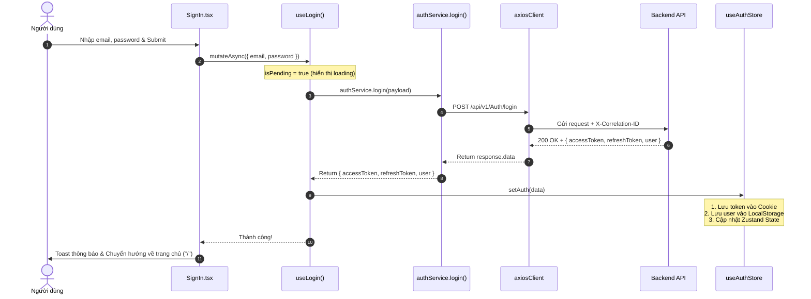
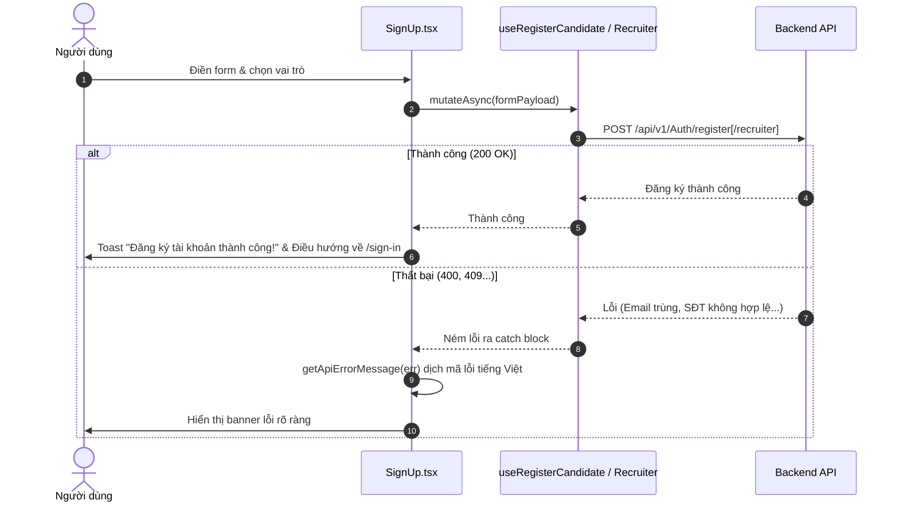
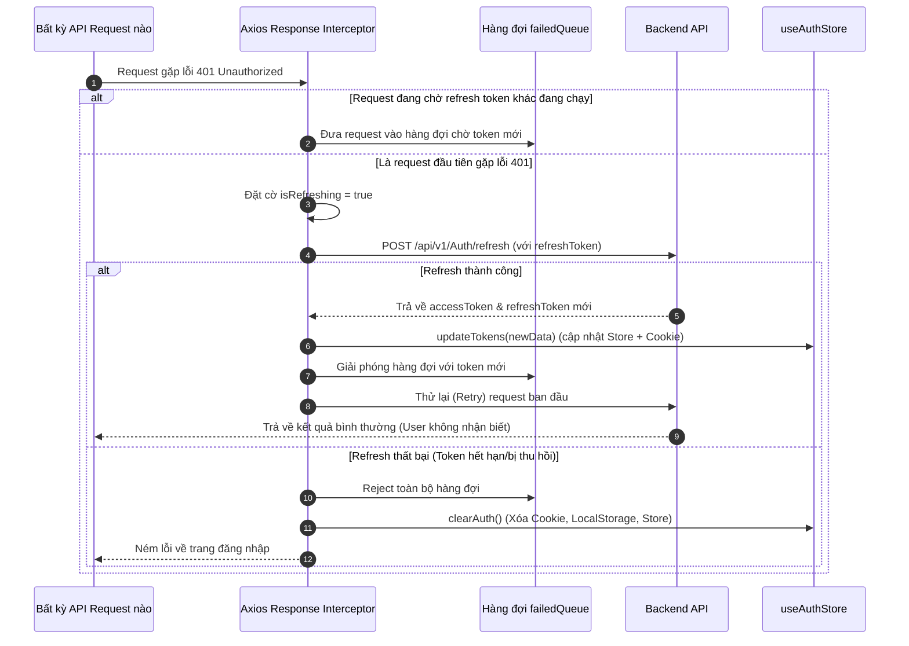
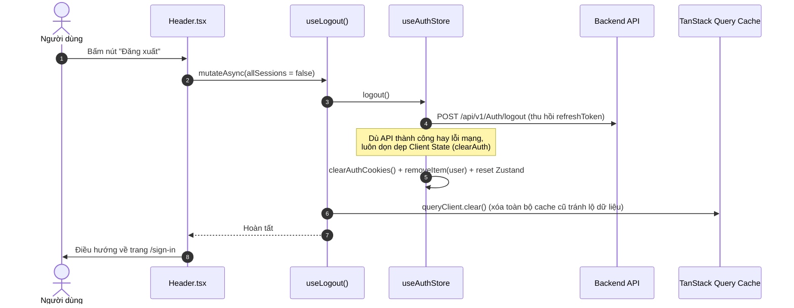

# 🔐 TÀI LIỆU LUỒNG XÁC THỰC VÀ QUẢN LÝ DỮ LIỆU (AUTH & DATA FLOW)

Tài liệu này mô tả chi tiết toàn bộ kiến trúc và vòng đời dữ liệu xác thực (Authentication Lifecycle) của ứng dụng **SmartHire Frontend**, bao gồm sự phối hợp giữa **TanStack Query**, **Zustand Store**, **Axios Interceptor**, **Cookie**, và **Global Error Handler**.

---

## 📌 1. Tổng quan kiến trúc (Architecture Overview)

```
┌────────────────────────────────────────────────────────────────────────┐
│                              GIAO DIỆN UI                              │
│                    (SignIn.tsx, SignUp.tsx, Header.tsx)                │
└───────────────────────────────────┬────────────────────────────────────┘
                                    │ gọi hook mutation
                                    ▼
┌────────────────────────────────────────────────────────────────────────┐
│                        TANSTACK QUERY (MUTATIONS)                      │
│            useLogin(), useRegisterCandidate(), useLogout()...          │
└──────────────────┬─────────────────────────────────┬───────────────────┘
                   │ gọi service                     │ cập nhật store
                   ▼                                 ▼
┌──────────────────────────────────────┐  ┌──────────────────────────────┐
│             API SERVICES             │  │         ZUSTAND STORE        │
│          (src/services/*.ts)         │  │   (Single Source of Truth)   │
└──────────────────┬───────────────────┘  └──────────────┬───────────────┘
                   │ gọi axiosClient                     │ đồng bộ
                   ▼                                     ▼
┌────────────────────────────────────────────────────────────────────────┐
│                        AXIOS CLIENT & INTERCEPTORS                     │
│  - Gắn Token & X-Correlation-ID tự động                                │
│  - Bắt lỗi 401 -> Silent Token Refresh (Queue chống nghẽn)             │
│  - Bắt lỗi mạng & API -> Global Error Handler                          │
└──────────────────┬─────────────────────────────────┬───────────────────┘
                   │ HTTP Request                    │
                   ▼                                 ▼
┌──────────────────────────────────────┐  ┌──────────────────────────────┐
│            BACKEND API               │  │    STORAGE & COOKIE LAYER    │
│            (SmartHire.Api)           │  │ (Cookie: tokens, LS: user)  │
└──────────────────────────────────────┘  └──────────────────────────────┘
```

---

## 💾 2. Chiến lược lưu trữ dữ liệu (Storage Strategy)

Để đảm bảo tính bảo mật, hiệu năng và tránh "lệch pha" trạng thái, ứng dụng áp dụng nguyên tắc **Single Source of Truth (Nguồn chân lý duy nhất)**:

| Loại dữ liệu | Nơi lưu trữ chính | Nơi lưu trữ dự phòng (Persist) | Mục đích & Đặc điểm |
| :--- | :--- | :--- | :--- |
| **Access Token** | Zustand Memory (`state.accessToken`) | Cookie (`sh_access_token`) | Dùng để xác thực request (`Bearer <token>`). Tự mất khi đóng tab nếu không lưu cookie. |
| **Refresh Token** | Zustand Memory (`state.refreshToken`) | Cookie (`sh_refresh_token`) | Dùng để xin cấp lại Access Token mới khi hết hạn. Lưu trong Cookie có hạn (mặc định 7 ngày). |
| **User Profile** | Zustand Memory (`state.user`) | LocalStorage (`sh_auth_user`) | Chứa thông tin họ tên, email, roles để hiển thị avatar, menu mà không cần gọi lại API mỗi lần F5. |

> 💡 **Quy tắc vàng:** Mọi component chỉ đọc dữ liệu từ `useAuthStore`. Khi token thay đổi (login, refresh, logout), hàm trong `authStore` sẽ tự động cập nhật đồng thời cả Zustand Memory, Cookie và LocalStorage.

---

## 🔄 3. Chi tiết các luồng dữ liệu (Workflows)

### 3.1. Luồng Đăng nhập (Sign In Flow)



---

### 3.2. Luồng Đăng ký (Sign Up Flow)

Ứng dụng hỗ trợ 2 vai trò qua 2 hook chuyên biệt:
- **Ứng viên:** `useRegisterCandidate()`
- **Nhà tuyển dụng:** `useRegisterRecruiter()`



---

### 3.3. Luồng Tự động Refresh Token (Silent Refresh & Concurrency Queue)

Khi Access Token hết hạn trong lúc người dùng đang thao tác:



---

### 3.4. Luồng Đăng xuất (Logout Flow)



---

## 🛡️ 4. Xử lý lỗi toàn cục (Global Error Handling)

Hệ thống xử lý lỗi theo mô hình đa tầng:
1. **Tầng Request/Response (`axiosClient`):**
   - Mọi lỗi không phải 401 được chuyển qua `handleApiError(error)` để ghi log chuẩn xác (có mã lỗi và ngữ cảnh).
2. **Tầng Trình bày (`errorHandler.ts` + `apiErrorsMessage.ts`):**
   - Hàm `getApiErrorMessage(error, fallback)` tự động bóc tách:
     - Lỗi validation từng trường (Field: `email`, `phone` -> Hiển thị câu tiếng Việt tương ứng).
     - Mã lỗi nghiệp vụ cụ thể từ backend (như `AUTH_EMAIL_ALREADY_EXISTS`, `AUTH_INVALID_CREDENTIALS`).
     - Mã trạng thái HTTP (400, 401, 403, 404, 500...).

---

## 👨‍💻 5. Hướng dẫn thêm API mới (Developer Guide)

Dành cho thành viên mới muốn thêm API mới vào dự án:

### Bước 1: Khai báo Endpoint vào `src/constants/apiEndpoints.ts`
```typescript
export const API_ENDPOINTS = {
  // ...
  JOB: {
    LIST: "/api/v1/Job",
    DETAIL: (id: string) => `/api/v1/Job/${id}`,
  },
};
```

### Bước 2: Tạo hàm gọi API trong `src/services/jobService.ts`
```typescript
import axiosClient from "@/api/axios";
import { API_ENDPOINTS } from "@/constants/apiEndpoints";

export const jobService = {
  async getJobs() {
    return await axiosClient.get(API_ENDPOINTS.JOB.LIST);
  },
};
```

### Bước 3: Tạo Custom Hook TanStack Query trong `src/hooks/queries/useJobs.ts`
```typescript
import { useQuery } from "@tanstack/react-query";
import { jobService } from "@/services/jobService";

export const useJobs = () => {
  return useQuery({
    queryKey: ["jobs"],
    queryFn: () => jobService.getJobs(),
  });
};
```

### Bước 4: Sử dụng trong UI
```tsx
const { data, isLoading, isError } = useJobs();
```
Không cần phải viết `useState`, `useEffect`, hay tự quản lý loading thủ công!
