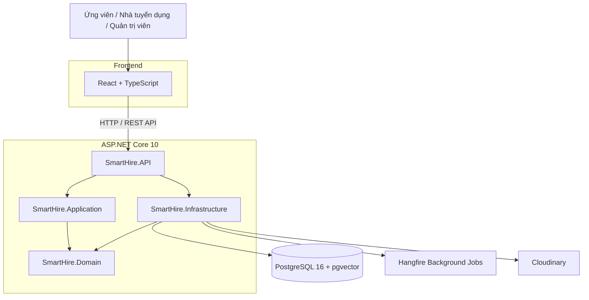

 <div align="center">

# SmartHire - AI-Powered Recruitment Platform

<p>
  <strong>Nền tảng tuyển dụng thông minh và xây dựng CV tích hợp AI</strong>
</p>

<p>
  Kết nối ứng viên với nhà tuyển dụng, tối ưu hóa quy trình tuyển dụng
  và hỗ trợ phát triển hồ sơ nghề nghiệp trên một nền tảng duy nhất.
</p>

<hr/>

<p>
  
  
  <a href="https://github.com/SE-Project-CTU/smart-recruitment-app/actions/workflows/deploy-backend.yml">
    
  </a>
</p>

<h2>Built With</h2>

<p>
  
  
  
  
  
</p>

<p>
  
  
  
  
</p>

<br/>

<a href="https://smart-recruitment-app.vercel.app/">
  
</a>
<a href="https://github.com/SE-Project-CTU/smart-recruitment-docs">
  
</a>

</div>

---

## 1. Giới thiệu

**SmartHire** là nền tảng kết nối ứng viên và nhà tuyển dụng, được phát triển trong khuôn khổ môn học Niên luận ngành Kỹ thuật phần mềm tại Trường Đại học Cần Thơ.

Dự án hướng đến việc số hóa quy trình tuyển dụng, từ quản lý hồ sơ cá nhân, xây dựng CV, tìm kiếm việc làm đến đăng tin tuyển dụng và quản lý ứng viên.

Bên cạnh các nghiệp vụ tuyển dụng cốt lõi, SmartHire định hướng tích hợp trí tuệ nhân tạo (AI) nhằm hỗ trợ xây dựng CV, phân tích mức độ phù hợp giữa ứng viên và công việc, đồng thời cải thiện hiệu quả tìm kiếm nhân sự.

### Mục tiêu dự án

- **Đối với ứng viên:** Đơn giản hóa quá trình tìm kiếm việc làm, xây dựng CV và theo dõi hồ sơ ứng tuyển.
- **Đối với nhà tuyển dụng:** Tập trung quy trình đăng tin, tiếp nhận và quản lý hồ sơ ứng viên.
- **Đối với hệ thống:** Xây dựng kiến trúc phần mềm có khả năng mở rộng, dễ bảo trì và thuận tiện tích hợp các dịch vụ bên ngoài.

> **Trạng thái dự án:** SmartHire đang trong quá trình phát triển. Các chức năng AI và nghiệp vụ được mô tả theo phạm vi dự án, không đồng nghĩa với việc tất cả đã được triển khai hoàn chỉnh.

## 2. Chức năng chính

### 2.1. Ứng viên

- **Quản lý hồ sơ cá nhân:** Cập nhật thông tin và dữ liệu nghề nghiệp.
- **Xây dựng CV:** Tạo và chỉnh sửa CV thông qua trình biên tập nội dung.
- **Tìm kiếm việc làm:** Khám phá cơ hội nghề nghiệp theo các tiêu chí phù hợp.
- **Ứng tuyển trực tuyến:** Gửi hồ sơ đến nhà tuyển dụng và theo dõi tiến trình xử lý.
- **Hỗ trợ bằng AI:** Định hướng phân tích CV, đối chiếu kỹ năng với yêu cầu công việc và đề xuất cơ hội nghề nghiệp phù hợp.

### 2.2. Nhà tuyển dụng

- **Quản lý thông tin công ty:** Cập nhật hồ sơ và thông tin doanh nghiệp.
- **Quản lý tin tuyển dụng:** Tạo, chỉnh sửa và quản lý các vị trí tuyển dụng.
- **Quản lý ứng viên:** Tiếp nhận và xem xét hồ sơ ứng tuyển.
- **Theo dõi quy trình tuyển dụng:** Quản lý trạng thái hồ sơ qua các giai đoạn xử lý.

### 2.3. Quản trị viên

- **Quản lý người dùng:** Hỗ trợ quản lý tài khoản và quyền truy cập.
- **Kiểm soát nội dung:** Hỗ trợ quản lý thông tin tuyển dụng và dữ liệu liên quan.
- **Quản lý dữ liệu hệ thống:** Định hướng quản lý các danh mục phục vụ nghiệp vụ tuyển dụng.

---

## 3. Công nghệ sử dụng

### Frontend

| Công nghệ      | Mục đích                                                 |
| -------------- | -------------------------------------------------------- |
| React 19       | Xây dựng giao diện theo mô hình component                |
| TypeScript 6   | Kiểm soát kiểu dữ liệu và tăng tính an toàn của mã nguồn |
| Vite 8         | Công cụ phát triển và đóng gói ứng dụng                  |
| Tailwind CSS 4 | Xây dựng giao diện bằng utility classes                  |
| React Router   | Điều hướng phía Client                                   |
| Axios          | Giao tiếp HTTP với Backend API                           |
| Zustand        | Quản lý trạng thái ứng dụng                              |
| TipTap         | Biên tập nội dung cho CV Builder                         |
| Lucide React   | Biểu tượng giao diện                                     |

### Backend

| Công nghệ                    | Mục đích                             |
| ---------------------------- | ------------------------------------ |
| ASP.NET Core 10              | Xây dựng RESTful API                 |
| C#                           | Ngôn ngữ lập trình Backend           |
| Entity Framework Core 10     | ORM và quản lý dữ liệu               |
| Npgsql                       | Kết nối PostgreSQL                   |
| Pgvector.EntityFrameworkCore | Tích hợp lưu trữ và truy vấn vector  |
| Hangfire                     | Xử lý tác vụ nền và tác vụ theo lịch |
| NLog                         | Ghi log ứng dụng                     |
| NSwag / OpenAPI              | Mô tả và khám phá API                |
| JWT                          | Hỗ trợ xác thực bằng token           |

### Database, lưu trữ và DevOps

| Công nghệ      | Mục đích                                           |
| -------------- | -------------------------------------------------- |
| PostgreSQL 16  | Hệ quản trị cơ sở dữ liệu quan hệ                  |
| pgvector       | Hỗ trợ lưu trữ và truy vấn vector embedding        |
| Cloudinary     | Tích hợp dịch vụ lưu trữ media                     |
| Docker         | Đóng gói ứng dụng trong container                  |
| Docker Compose | Khởi chạy và điều phối các dịch vụ                 |
| Nginx          | Phục vụ Frontend trong container                   |
| GitHub Actions | Tự động hóa quy trình CI/CD                        |
| Snyk           | Kiểm tra lỗ hổng bảo mật dependency trong pipeline |

---

## 4. Kiến trúc hệ thống

SmartHire tổ chức Backend theo các lớp tách biệt, lấy cảm hứng từ **Clean Architecture**, giúp phân tách nghiệp vụ cốt lõi khỏi các chi tiết triển khai và hạ tầng.



### Các lớp Backend

| Project                    | Trách nhiệm                                                                   |
| -------------------------- | ----------------------------------------------------------------------------- |
| `SmartHire.API`            | Tiếp nhận HTTP requests, cấu hình middleware và cung cấp API                  |
| `SmartHire.Application`    | Chứa các use case và abstraction phục vụ nghiệp vụ ứng dụng                   |
| `SmartHire.Domain`         | Chứa các thực thể, value objects và quy tắc nghiệp vụ cốt lõi                 |
| `SmartHire.Infrastructure` | Triển khai persistence, Entity Framework Core, migrations và tích hợp hạ tầng |

### Nguyên tắc thiết kế

- Tách biệt nghiệp vụ cốt lõi khỏi công nghệ triển khai.
- Giảm sự phụ thuộc giữa các tầng của hệ thống.
- Sử dụng Dependency Injection để quản lý các thành phần phụ thuộc.
- Hỗ trợ kiểm thử, bảo trì và mở rộng các module.
- Quản lý cấu hình và thông tin nhạy cảm thông qua biến môi trường hoặc cơ chế lưu trữ bí mật phù hợp.

---

## 5. Cấu trúc dự án

```text
smart-recruitment-app/
├── .github/
│   └── workflows/
│       └── deploy-backend.yml
│
├── Backend/
│   ├── SmartHire.slnx
│   ├── dotnet-tools.json
│   └── src/
│       ├── SmartHire.API/
│       │   ├── Controllers/
│       │   ├── Middleware/
│       │   ├── Program.cs
│       │   └── SmartHire.Api.csproj
│       │
│       ├── SmartHire.Application/
│       ├── SmartHire.Domain/
│       └── SmartHire.Infrastructure/
│
├── Frontend/
│   ├── Dockerfile
│   └── src/
│       ├── api/
│       ├── components/
│       ├── layouts/
│       ├── routes/
│       ├── pages/
│       ├── services/
│       ├── stores/
│       ├── types/
│       └── utils/
│
├── .env.example
├── compose.yaml
├── LICENSE
├── README.md
└── SETUP.md
```

| Thành phần           | Mô tả                                                        |
| -------------------- | ------------------------------------------------------------ |
| `Backend/`           | Mã nguồn ASP.NET Core và các project theo kiến trúc phân lớp |
| `Frontend/`          | Mã nguồn React, TypeScript và cấu hình đóng gói              |
| `.github/workflows/` | Quy trình tự động hóa CI/CD                                  |
| `compose.yaml`       | Cấu hình các dịch vụ Docker                                  |
| `.env.example`       | Mẫu biến môi trường                                          |

---

## 6. Cài đặt và chạy dự án

SmartHire sử dụng Docker Compose để khởi chạy Frontend, Backend API và PostgreSQL trong môi trường phát triển.

### 6.1. Yêu cầu

- [Git](https://git-scm.com/)
- [Docker Desktop](https://www.docker.com/products/docker-desktop/)

Không cần cài đặt riêng Node.js hoặc .NET SDK để khởi chạy toàn bộ ứng dụng bằng Docker. Việc tạo Entity Framework Core migration từ máy host cần .NET SDK 10 và công cụ `dotnet-ef`.

### 6.2. Clone repository

```bash
git clone https://github.com/SE-Project-CTU/smart-recruitment-app.git

cd smart-recruitment-app
```

### 6.3. Cấu hình biến môi trường

Tạo file `Backend/.env` từ file `.env.example` ở thư mục gốc.

**Windows PowerShell**

```powershell
Copy-Item .env.example Backend/.env
```

**Windows CMD**

```cmd
copy .env.example Backend\.env
```

**Linux / macOS / Git Bash**

```bash
cp .env.example Backend/.env
```

Mở `Backend/.env`, cập nhật các giá trị cần thiết:

```dotenv
POSTGRES_DB=smarthire_dev
POSTGRES_USER=smarthire_app
POSTGRES_PASSWORD=your_local_password

VITE_API_BASE_URL=http://localhost:5190

Cloudinary__CloudName=your_cloudinary_cloud_name
Cloudinary__ApiKey=your_cloudinary_api_key
Cloudinary__ApiSecret=your_cloudinary_api_secret

Jwt__SigningKey=your_secret_key
```

Thay các giá trị mẫu bằng thông tin cấu hình phù hợp với môi trường của bạn. Không sử dụng các giá trị ví dụ làm thông tin xác thực thật trong môi trường triển khai.

> Không commit file `.env`, mật khẩu database, JWT signing key hoặc thông tin xác thực dịch vụ bên ngoài lên GitHub.

### 6.4. Khởi chạy ứng dụng

Từ thư mục gốc của repository:

```bash
docker compose --env-file Backend/.env up --build
```

Chạy ứng dụng ở chế độ nền:

```bash
docker compose --env-file Backend/.env up --build -d
```

Kiểm tra trạng thái các container:

```bash
docker compose --env-file Backend/.env ps
```

### 6.5. Truy cập các dịch vụ

| Dịch vụ               | URL                                                                            |
| --------------------- | ------------------------------------------------------------------------------ |
| Frontend              | [http://localhost:5173](http://localhost:5173)                                 |
| Swagger UI            | [http://localhost:5190/swagger](http://localhost:5190/swagger)                 |
| OpenAPI Specification | [http://localhost:5190/openapi/v1.json](http://localhost:5190/openapi/v1.json) |
| Hangfire Dashboard    | [http://localhost:5190/hangfire](http://localhost:5190/hangfire)               |

### 6.6. Xem log

Log Backend API:

```bash
docker compose --env-file Backend/.env logs api --tail=50
```

Log Frontend:

```bash
docker compose --env-file Backend/.env logs frontend --tail=30
```

### 6.7. Dừng ứng dụng

Dừng các container và giữ lại dữ liệu database:

```bash
docker compose --env-file Backend/.env down
```

Dừng các container và xóa volume dữ liệu:

```bash
docker compose --env-file Backend/.env down -v
```

> **Cảnh báo:** Lệnh `down -v` có thể xóa dữ liệu PostgreSQL được lưu trong Docker volume. Chỉ sử dụng khi bạn thực sự muốn reset database phát triển.

### 6.8. Quản lý database migrations

Entity Framework Core migrations được cấu hình áp dụng khi API container khởi động.

Khi thay đổi Entity hoặc cấu trúc dữ liệu, cần tạo migration mới và commit cả migration file lẫn `SmartHireDbContextModelSnapshot.cs`.

Hướng dẫn tạo migration, cấu hình User Secrets và kết nối database từ máy host được trình bày trong [`SETUP.md`](SETUP.md).

---

## 7. CI/CD và bảo mật

Dự án có GitHub Actions workflow cho Backend, bao gồm các công đoạn chính:

- **Database migration:** Áp dụng Entity Framework Core migrations vào database được cấu hình.
- **Dependency security scanning:** Sử dụng Snyk để kiểm tra các lỗ hổng dependency theo ngưỡng severity được thiết lập.
- **Docker build:** Xây dựng image cho Backend API.
- **Image publishing:** Đẩy image lên Docker Hub.
- **Deployment trigger:** Kích hoạt quy trình triển khai Backend trên Render.

Các bước triển khai phụ thuộc vào GitHub Secrets và cấu hình dịch vụ tương ứng. Trạng thái workflow thực tế được hiển thị qua badge CI/CD ở đầu README.

---

## 8. Tài liệu dự án

Tài liệu phân tích, thiết kế và báo cáo được quản lý trong repository riêng:

**[smart-recruitment-docs](https://github.com/SE-Project-CTU/smart-recruitment-docs)**

| Tài liệu                                                                                                         | Nội dung                                  |
| ---------------------------------------------------------------------------------------------------------------- | ----------------------------------------- |
| [Requirement Specification](https://github.com/SE-Project-CTU/smart-recruitment-docs/tree/main/requirement-spec) | Đặc tả yêu cầu chức năng và phi chức năng |
| [Design Specification](https://github.com/SE-Project-CTU/smart-recruitment-docs/tree/main/design-spec)           | Tài liệu thiết kế hệ thống                |
| [API Specification](https://github.com/SE-Project-CTU/smart-recruitment-docs/tree/main/api-spec)                 | Tài liệu đặc tả API                       |
| [System Diagrams](https://github.com/SE-Project-CTU/smart-recruitment-docs/tree/main/diagrams)                   | Sơ đồ và mô hình hệ thống                 |
| [Project Report](https://github.com/SE-Project-CTU/smart-recruitment-docs/tree/main/report)                      | Tài liệu báo cáo dự án                    |
| [Setup Guide](SETUP.md)                                                                                          | Hướng dẫn cài đặt và phát triển ứng dụng  |

---

## 9. Thành viên dự án

**Nhóm 1 — Niên luận ngành Kỹ thuật phần mềm, Trường Đại học Cần Thơ**

| Thành viên       | Vai trò                         |
| ---------------- | ------------------------------- |
| Phan Quốc Bình   | Product Owner, Development Team |
| Trần Trọng Phúc  | Scrum Master, Development Team  |
| Nguyễn Phước Lộc | Development Team                |

Nhóm tổ chức công việc dựa trên Scrum, kết hợp quản lý yêu cầu, phân chia nhiệm vụ, phát triển tính năng, review mã nguồn và tự động hóa quy trình triển khai.

---

## 10. Định hướng phát triển

- Hoàn thiện các nghiệp vụ tuyển dụng và quản lý hồ sơ ứng viên.
- Cải thiện trải nghiệm xây dựng, chỉnh sửa và quản lý CV.
- Phát triển các tính năng AI hỗ trợ phân tích CV và đối chiếu yêu cầu công việc.
- Nghiên cứu sử dụng vector embedding và pgvector cho tìm kiếm ngữ nghĩa.
- Nâng cao chất lượng kiểm thử, ghi log, bảo mật và khả năng vận hành hệ thống.
- Tiếp tục cải thiện quy trình CI/CD và quản lý cấu hình môi trường.

---

## 11. Giấy phép

Dự án được phát hành theo [MIT License](LICENSE).

<div align="center">

**SmartHire — Connecting Talent with Opportunities.**

<sub>Built with ASP.NET Core, React, TypeScript and PostgreSQL.</sub>

</div>
